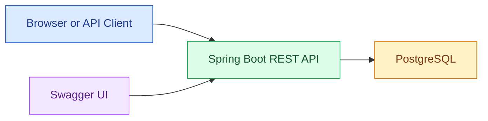
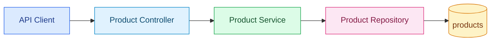
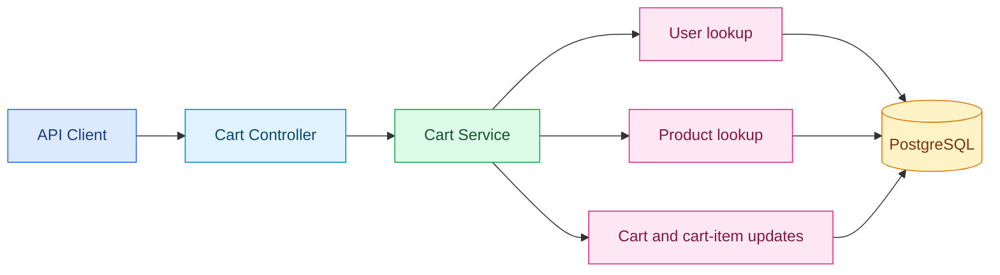
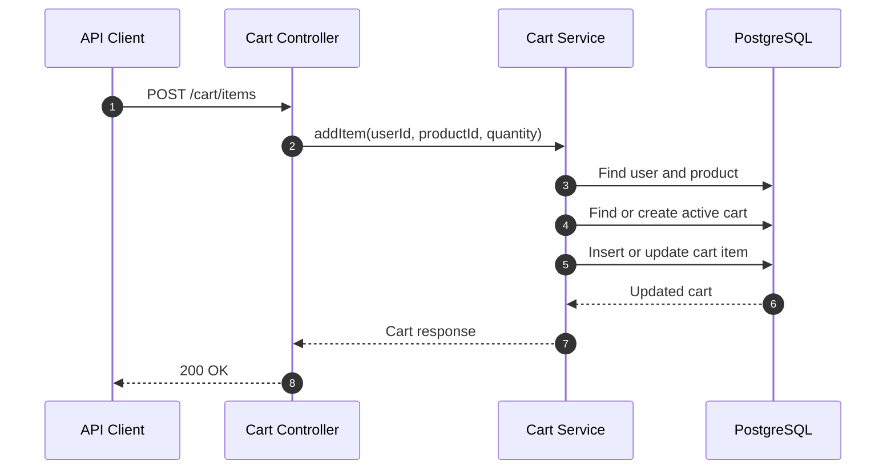
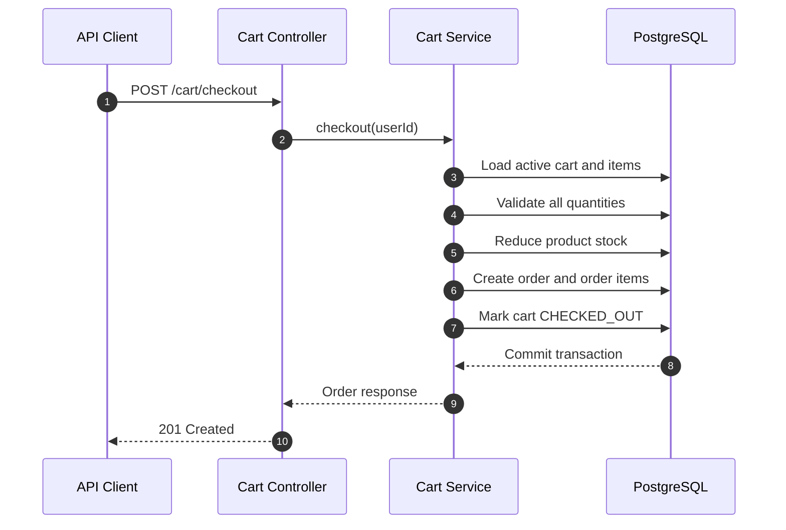
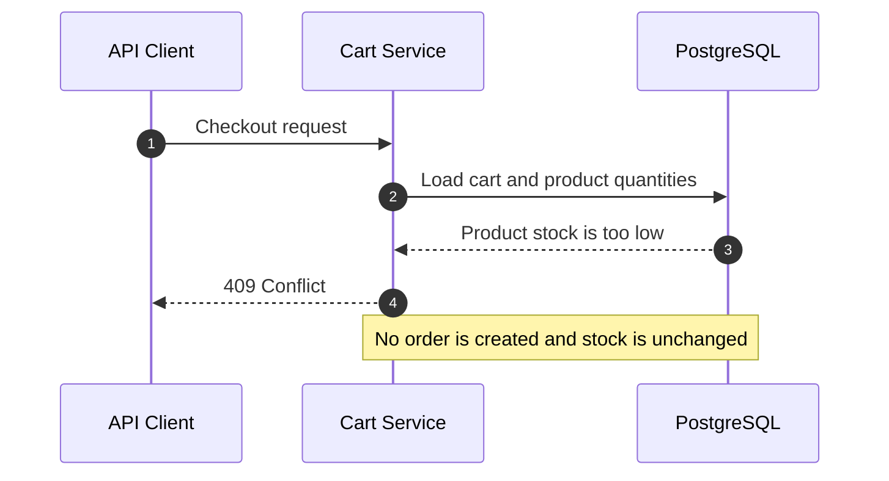

# Spring Boot E-Commerce Backend

Backend service for a small e-commerce workflow: products, carts, checkout, and order history.

## Stack

- Java 21 and Spring Boot
- PostgreSQL 16
- Spring Data JPA
- Gradle
- Docker Compose
- Springdoc OpenAPI

## Features

- Product catalog with seeded electronics and clothing items
- One active cart per user
- Add, update, and remove cart items
- Transactional checkout with stock validation
- Order history and order details
- Consistent JSON error responses
- Swagger UI for API exploration

## Architecture

### System overview



The REST API owns the catalog, cart, checkout, and order flows. PostgreSQL stores operational data and seed records.

### Catalog flow



### Cart flow



### Checkout transaction

```mermaid
flowchart LR
    Checkout[Checkout request]:::client --> Load[Load active cart]:::service
    Load --> Validate[Validate product stock]:::service
    Validate --> Stock[Reduce product quantities]:::service
    Stock --> Order[Create order and order items]:::service
    Order --> Close[Mark cart checked out]:::service
    Close --> Database[(PostgreSQL transaction)]:::database

    classDef client fill:#DBEAFE,stroke:#2563EB,color:#1E3A8A
    classDef service fill:#DCFCE7,stroke:#16A34A,color:#14532D
    classDef database fill:#FEF3C7,stroke:#D97706,color:#78350F
```



Checkout runs inside one database transaction. A stock failure returns `409 Conflict` before any product quantity or order record is changed.

## Request sequences

### Add an item to a cart



### Checkout with available stock



### Checkout with insufficient stock



## API overview

| Method | Endpoint | Purpose |
| --- | --- | --- |
| GET | `/api/products` | List products |
| GET | `/api/products/{productId}` | Get a product |
| GET | `/api/users/{userId}/cart` | Get active cart |
| POST | `/api/users/{userId}/cart/items` | Add a cart item |
| PATCH | `/api/users/{userId}/cart/items/{productId}` | Change item quantity |
| DELETE | `/api/users/{userId}/cart/items/{productId}` | Remove a cart item |
| POST | `/api/users/{userId}/cart/checkout` | Create an order |
| GET | `/api/users/{userId}/orders` | List user orders |
| GET | `/api/orders/{orderId}` | Get order details |

## Local run

Requirements: Java 21 and Docker.

```bash
cp .env.example .env
docker compose up -d postgres
docker compose ps
chmod +x gradlew
./gradlew bootRun
```

PostgreSQL listens on `localhost:5432`. The API listens on `http://localhost:8080`.

Database tables and seed records are defined in `database/schema.sql` and `database/data.sql`. Docker loads them when the PostgreSQL volume is created.

## Tests

```bash
./gradlew test
```

The unit tests cover cart changes and checkout success and failure cases. JaCoCo writes an HTML report to `build/reports/jacoco/test/html/index.html`. GitHub Actions runs the same command on pushes and pull requests.

## API documentation

- Swagger UI: `http://localhost:8080/swagger-ui/index.html`
- OpenAPI JSON: `http://localhost:8080/v3/api-docs`

## Example flow

```bash
curl http://localhost:8080/api/products

curl -X POST http://localhost:8080/api/users/1/cart/items \
  -H "Content-Type: application/json" \
  -d '{"productId":1,"quantity":2}'

curl http://localhost:8080/api/users/1/cart

curl -X PATCH http://localhost:8080/api/users/1/cart/items/1 \
  -H "Content-Type: application/json" \
  -d '{"quantity":3}'

curl -X POST http://localhost:8080/api/users/1/cart/checkout

curl http://localhost:8080/api/users/1/orders
```

Product `5` has zero stock and can be used to check the `409 Conflict` checkout response.

```bash
curl -X POST http://localhost:8080/api/users/1/cart/items \
  -H "Content-Type: application/json" \
  -d '{"productId":5,"quantity":1}'

curl -X POST http://localhost:8080/api/users/1/cart/checkout
```

## Reset local data

```bash
docker compose down -v
docker compose up -d postgres
```

## Scope

The current version focuses on the checkout workflow and basic stock checks. Authentication, RBAC, optimistic locking, Redis, Kafka, saga handling, CI, and AWS deployment are planned extensions.
