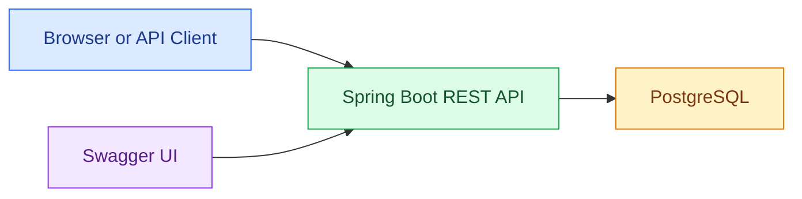
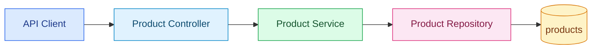
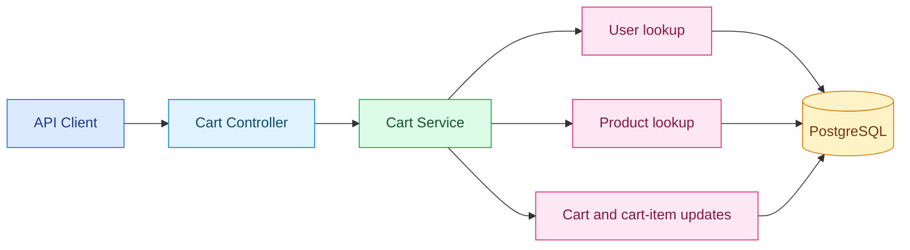
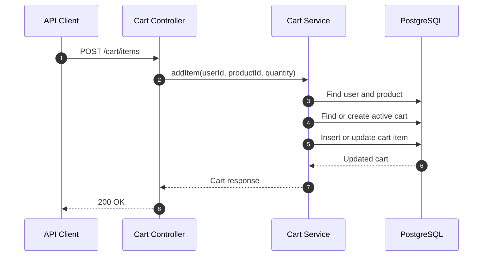
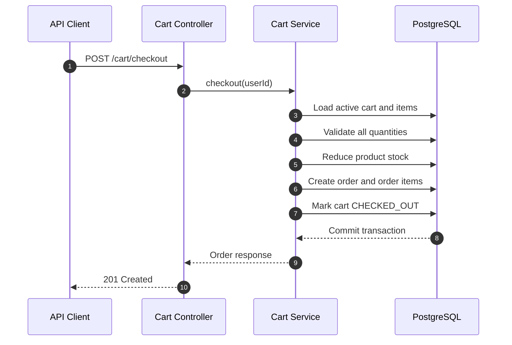
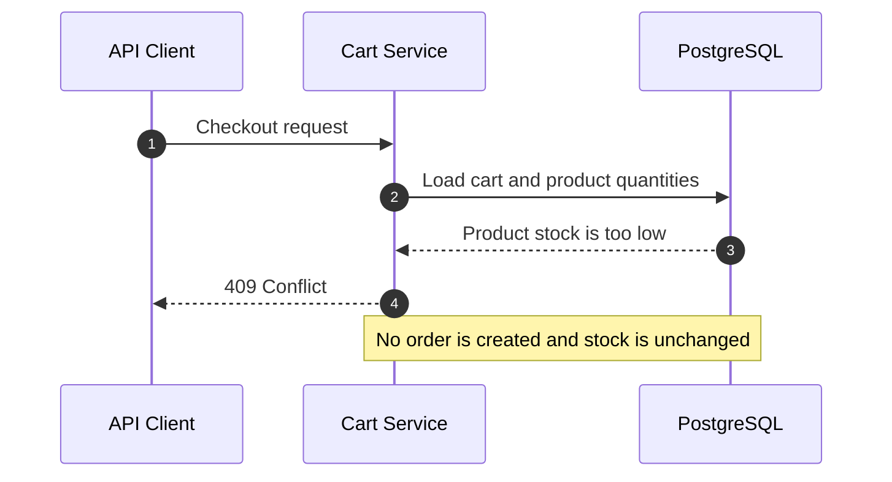

# Spring Boot E-Commerce Backend

Backend service for a small e-commerce workflow: products, carts, checkout, and order history.

## Stack

- Java 21 and Spring Boot
- PostgreSQL 16
- Spring Data JPA
- Gradle
- Docker Compose
- Springdoc OpenAPI

## Features

- Email-based login with two roles: customer and admin
- Product catalog with seeded electronics and clothing items, each with a two-option variant (size, color, tier)
- Admin product management: create, update (name, description, price, stock, variant), and soft delete
- One active cart per user, with variant-aware cart items
- Add, update, and remove cart items
- Transactional checkout with stock validation
- Discontinued products are hidden from the catalog and block checkout until removed from carts
- Order history and order details
- AI cart abandonment bot (Gemini) that detects abandoned carts and re-engages customers via chat
- Consistent JSON error responses
- Swagger UI for API exploration

## Architecture

### System overview



The REST API owns the catalog, cart, checkout, and order flows. PostgreSQL stores operational data and seed records.

### Catalog flow



### Cart flow



### Checkout transaction

```mermaid
flowchart LR
    Checkout[Checkout request]:::client --> Load[Load active cart]:::service
    Load --> Validate[Validate product stock]:::service
    Validate --> Stock[Reduce product quantities]:::service
    Stock --> Order[Create order and order items]:::service
    Order --> Close[Mark cart checked out]:::service
    Close --> Database[(PostgreSQL transaction)]:::database

    classDef client fill:#DBEAFE,stroke:#2563EB,color:#1E3A8A
    classDef service fill:#DCFCE7,stroke:#16A34A,color:#14532D
    classDef database fill:#FEF3C7,stroke:#D97706,color:#78350F
```



Checkout runs inside one database transaction. A stock failure returns `409 Conflict` before any product quantity or order record is changed.

## Request sequences

### Add an item to a cart



### Checkout with available stock



### Checkout with insufficient stock



## API overview

| Method | Endpoint | Purpose |
| --- | --- | --- |
| POST | `/api/auth/login` | Log in with an email, returns user id and role |
| GET | `/api/products` | List active products |
| GET | `/api/products/{productId}` | Get a product |
| POST | `/api/products` | Create a product (admin) |
| PATCH | `/api/products/{productId}` | Update name, description, price, or stock (admin) |
| DELETE | `/api/products/{productId}` | Soft delete a product (admin) |
| GET | `/api/products/all` | List all products including discontinued (admin) |
| GET | `/api/users/{userId}/cart` | Get active cart |
| POST | `/api/users/{userId}/cart/items` | Add a cart item |
| PATCH | `/api/users/{userId}/cart/items/{productId}` | Change item quantity |
| DELETE | `/api/users/{userId}/cart/items/{productId}` | Remove a cart item |
| POST | `/api/users/{userId}/cart/checkout` | Create an order |
| GET | `/api/users/{userId}/orders` | List user orders |
| GET | `/api/orders/{orderId}` | Get order details |
| GET | `/api/bot/engagement/{userId}` | Check if the bot should re-engage an abandoned cart |
| POST | `/api/bot/message` | Send a chat message to the bot |
| POST | `/api/bot/exit-intent` | Mark the cart abandoned when the user leaves |

Admin endpoints require the `X-User-Id` header of an admin account and return `403 Forbidden` otherwise. Deleting a product marks it `DISCONTINUED`; it disappears from the catalog, cannot be added to carts, and blocks checkout while it sits in a cart.

Cart item update/remove endpoints accept an optional `?variant=` query parameter to target a specific variant of a product.

## Cart Abandonment Bot

The bot re-engages customers who add items to a cart but don't check out. It triggers two ways:

1. **Exit intent** — the frontend fires a `pagehide` beacon when the user leaves with a non-empty cart; the bot greets them on their next visit.
2. **Time-out** — a 30-second in-page timer (and `last_activity_at` checks) detects an idle cart and nudges the user.

The bot reads the cart (items, variants, prices), builds a prompt, and calls Gemini to generate a friendly, personalized message. It answers follow-up questions about products and variants, and guides the customer back to checkout.

### Configuring the AI

Set `GEMINI_API_KEY` in `.env` (a free key from [Google AI Studio](https://aistudio.google.com)). Without a key, the bot falls back to templated messages so the flow still works.

```bash
GEMINI_API_KEY=AIza...
GEMINI_MODEL=gemini-2.0-flash
```

## Local run

Requirements: Java 21 and Docker.

```bash
cp .env.example .env
docker compose up -d postgres
docker compose ps
chmod +x gradlew
./gradlew bootRun
```

PostgreSQL listens on `localhost:5432`. The API and the storefront UI listen on `http://localhost:8080`.

Database tables and seed records are defined in `database/schema.sql` and `database/data.sql`. Docker loads them when the PostgreSQL volume is created. If you already had a volume from an older version, reset it once so the `role`, product `status`, variant, and bot tables exist:

```bash
docker compose down -v
docker compose up -d postgres
```

## Demo accounts

| Email | Role |
| --- | --- |
| alice@example.com | CUSTOMER |
| bob@example.com | CUSTOMER |
| charlie@example.com | CUSTOMER |
| david@example.com | CUSTOMER |
| eve@example.com | CUSTOMER |
| admin@shop.test | ADMIN |

## Tests

```bash
./gradlew test
```

The unit tests cover cart changes and checkout success and failure cases. JaCoCo writes an HTML report to `build/reports/jacoco/test/html/index.html`. GitHub Actions runs the same command on pushes and pull requests.

## API documentation

- Swagger UI: `http://localhost:8080/swagger-ui/index.html`
- OpenAPI JSON: `http://localhost:8080/v3/api-docs`

## Example flow

```bash
curl http://localhost:8080/api/products

curl -X POST http://localhost:8080/api/users/1/cart/items \
  -H "Content-Type: application/json" \
  -d '{"productId":1,"quantity":2}'

curl http://localhost:8080/api/users/1/cart

curl -X PATCH http://localhost:8080/api/users/1/cart/items/1 \
  -H "Content-Type: application/json" \
  -d '{"quantity":3}'

curl -X POST http://localhost:8080/api/users/1/cart/checkout

curl http://localhost:8080/api/users/1/orders
```

Product `5` has zero stock and can be used to check the `409 Conflict` checkout response.

```bash
curl -X POST http://localhost:8080/api/users/1/cart/items \
  -H "Content-Type: application/json" \
  -d '{"productId":5,"quantity":1}'

curl -X POST http://localhost:8080/api/users/1/cart/checkout
```

## Reset local data

```bash
docker compose down -v
docker compose up -d postgres
```

## Scope

The current version focuses on the checkout workflow and basic stock checks. Authentication, RBAC, optimistic locking, Redis, Kafka, saga handling, CI, and AWS deployment are planned extensions.
